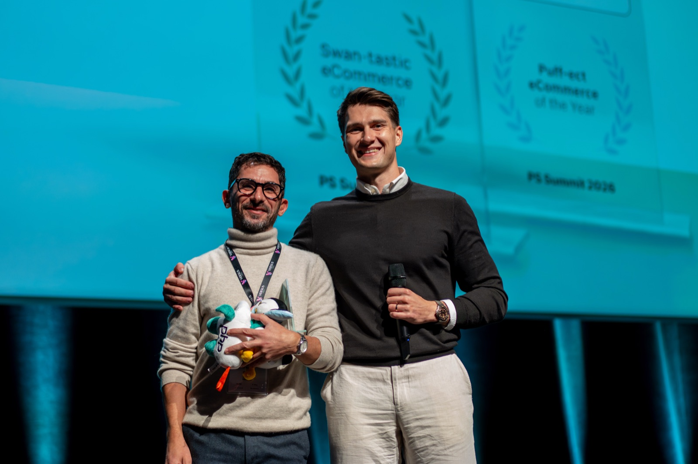
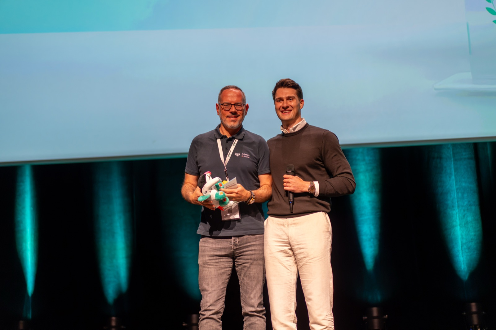
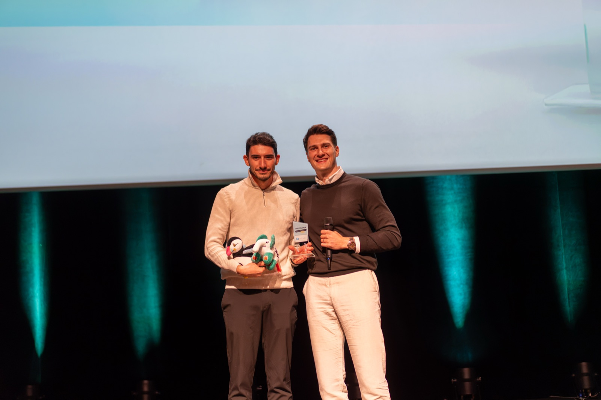
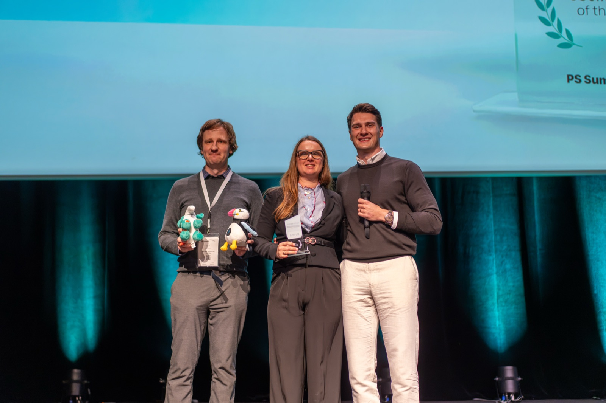
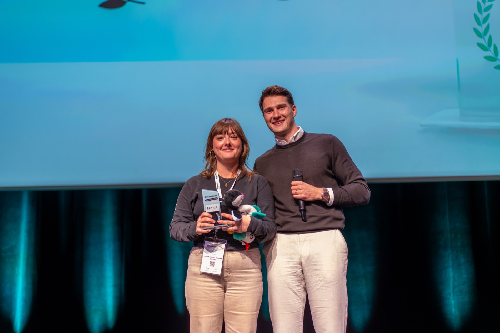
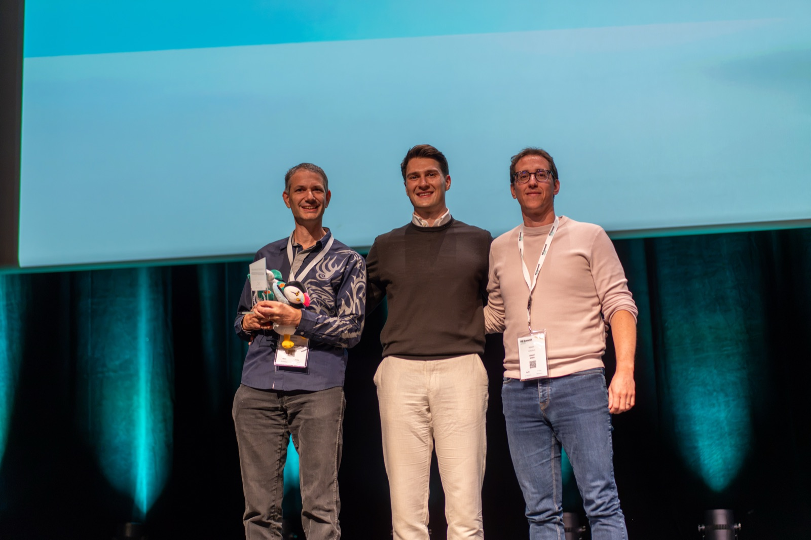
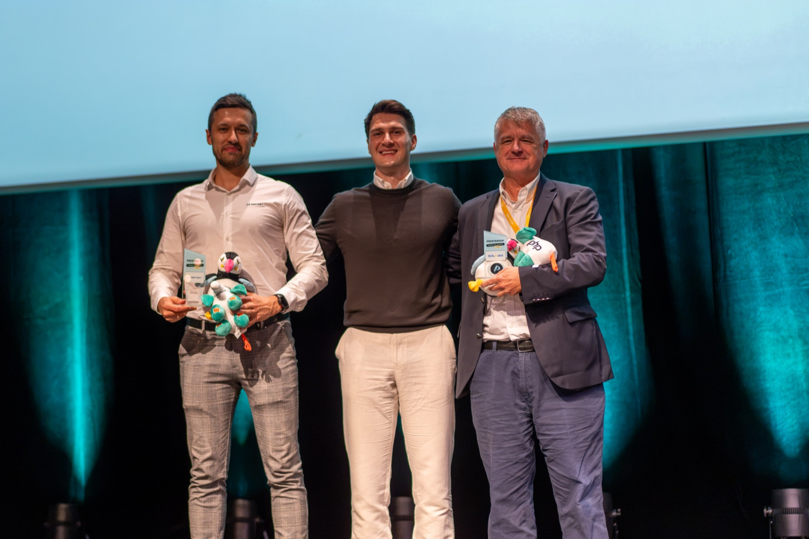
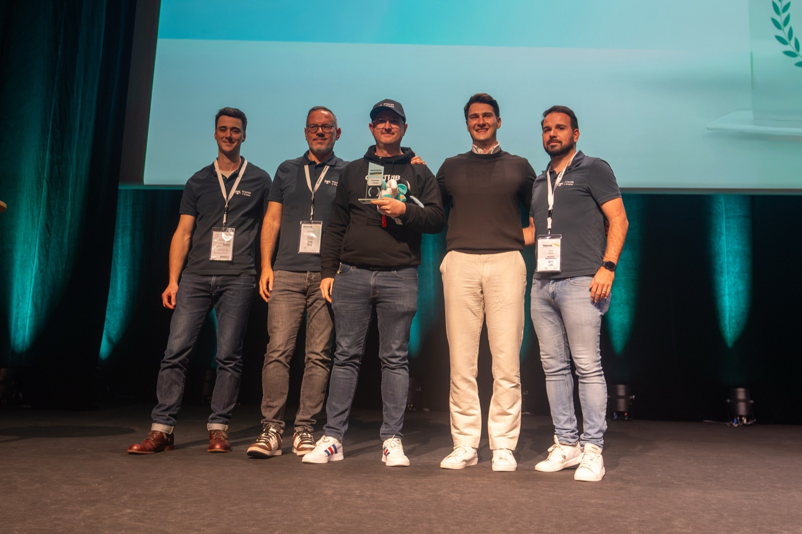
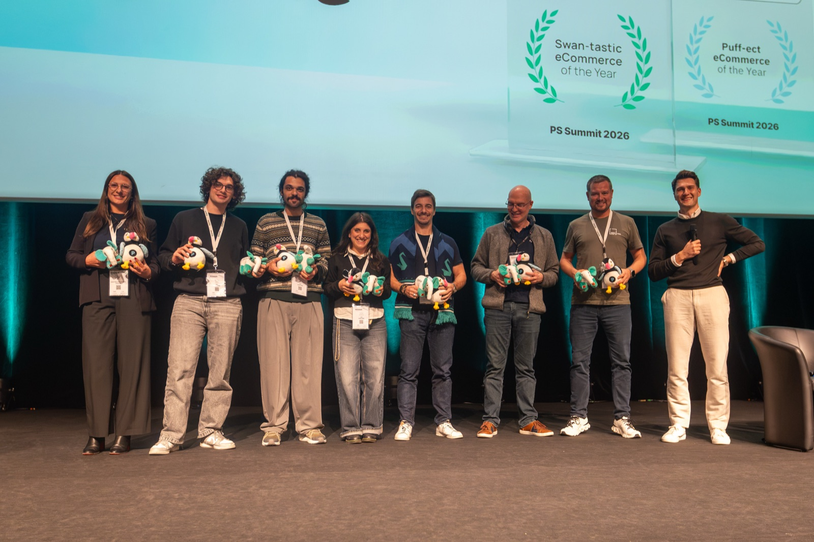

On November 5, the PS Summit in Lyon brought the PrestaShop and Sylius communities together for a full day of talks, demos and networking. In the afternoon, the main stage hosted the **very first PrestaShop Community Awards**.

[Mikołaj Król](https://www.linkedin.com/in/bitbager/), CEO of PrestaShop and Sylius, presented the winners and congratulated each of them. As he put it on stage, we would not be where we are without our community and the people who support our work every step of the way. These awards are our way of saying thank you.

<figure style="text-align: center;">
  
  <figcaption style="font-size: 0.875em; color: #6c757d;">Mikołaj Król, CEO of PrestaShop and Sylius, on stage at PS Summit 2026</figcaption>
</figure>

Some winners were in Lyon to collect their award in person. For those who couldn't make the trip, a colleague or a member of the PrestaShop team collected the award for them, and we will ship the rest to the winners.

## How the winners were chosen

The PrestaShop awards cover five categories:

* **Key Module Contributor**: for the person or agency who did the most to create, maintain and improve PrestaShop modules.
* **Regional Advocate**: one recipient per key market, chosen for overall activity: community involvement, marketing, sales support and presence at events.
* **Key Technology Partner**: for the technology partners that contributed most to merchant success this year, such as payment providers, hosting providers and software vendors.
* **Key Core Contributors**: three mentions instead of a single winner, so that no agency is ranked above another.
* **Outstanding Community Initiative**: for a person or organization behind an initiative that strengthens the community beyond code.

Whenever possible, we relied on contribution data from the [PrestaShop contributors ranking](https://contributors.prestashop.com/).

## Key Module Contributor: Daniel Hlaváček

If you work on PrestaShop modules, you have probably come across [Hlavtox](https://github.com/Hlavtox). **Daniel Hlaváček**, from the Czech Republic, led the contribution rankings this year for his work on PrestaShop modules.

Daniel couldn't be in Lyon, so [Krystian Podemski](https://www.linkedin.com/in/krystian-podemski/) collected the award and will hand it over to him. Thank you, Daniel, for everything you did this year!

## In Memoriam: Olivier Clemence

During the ceremony, we took a moment to remember **Olivier Clemence**. Many of you in the PrestaShop community knew him as the person behind Op'art, and through his contributions to the project over the years.

We honoured him with an In Memoriam tribute. [Stephan Obadia](https://www.linkedin.com/in/stephanobadia/) received the award on his behalf, and will carry Olivier's legacy forward.

<figure style="text-align: center;">
  
  <figcaption style="font-size: 0.875em; color: #6c757d;">Stephan Obadia receiving the In Memoriam award for Olivier Clemence on stage at PS Summit 2026</figcaption>
</figure>

## Regional Advocates

A merchant's first conversation about PrestaShop often happens locally, with people who know their market and speak their language. This year, we recognised four advocates for the work they do in their own markets: showing up at local events, supporting merchants and helping others get involved.

* **France: [Jean-François Viguier](https://www.linkedin.com/in/jfviguier/)**, for creating the Friends of Presta Contrib Academy and pushing for more contributions to the project.
* **Italy: [Hostinato](https://www.hostinato.it/it/)**, for their dedication to PrestaShop in Italy. Based in Legnano, near Milan, this ecommerce agency and system integrator has been building PrestaShop stores since 2014 and connecting them to ERPs, PIMs, CRMs and marketplaces.
* **Spain: [Francisco González Fernández](https://www.linkedin.com/in/fjgonzalezfdez/)**, CMO at [ARCON Food](https://arconfood.store/), a long-time advocate of PrestaShop. Since 1992, ARCON Food has been making and distributing bakery, pastry and HORECA products from Granollers, near Barcelona, and its professional online store runs on PrestaShop. It was high time we gave Francisco credit for his advocacy!
* **Poland: [Mateusz Haber](https://www.linkedin.com/in/mateusz-haber/)**, Founder and CEO of [Surf Inc.](https://surf.inc/), for his engagement in favour of PrestaShop. Surf Inc. is a European streetwear brand rooted in surf culture, selling online across Europe and beyond with PrestaShop.

Francisco and Mateusz couldn't attend, so Karolina Wozniak collected both awards and will make sure they reach them.

 

  <figure style="text-align: center;">
    
    <figcaption style="font-size: 0.875em; color: #6c757d;">Jean-François Viguier receiving the Regional Advocate award for France on stage at PS Summit 2026</figcaption>
  </figure>
 

 

  <figure style="text-align: center;">
    
    <figcaption style="font-size: 0.875em; color: #6c757d;">The Hostinato representative receiving the Regional Advocate award for Italy on stage at PS Summit 2026</figcaption>
  </figure>
 

## Key Technology Partners: PayPal and Klaviyo

On the morning of the Summit, we announced **PrestaShop Payments**. Given how challenging the project was and how much dedication it required, this award would not make sense without **PayPal**. Thank you to the PayPal team for making it happen!

Our second Key Technology Partner award goes to **Klaviyo**, for helping merchants generate more value and new revenue through great software.

 

  <figure style="text-align: center;">
    
    <figcaption style="font-size: 0.875em; color: #6c757d;">The PayPal representatives receiving the Key Technology Partner award on stage at PS Summit 2026</figcaption>
  </figure>
 

 

  <figure style="text-align: center;">
    
    <figcaption style="font-size: 0.875em; color: #6c757d;">The Klaviyo representative receiving the Key Technology Partner award on stage at PS Summit 2026</figcaption>
  </figure>
 

## Key Core Contributors

For the PrestaShop core, we chose to give three mentions, each recognising a different kind of contribution.

### Volume and Calls for Contribution: Paolo Cunti

When the PrestaShop team put out [Calls for Contribution](https://build.prestashop-project.org/news/2025/call-for-contributions-hooks-summary/), **[Paolo Cunti](https://www.linkedin.com/in/paolocunti/)** ([@Codencode](https://github.com/Codencode) on GitHub) from Codencode, in Italy, answered. This year, he ranked first by number of contributions to the PrestaShop core.

Paolo couldn't be in Lyon, so Krystian collected the award, and we will ship it to him. Grazie Paolo!

### Feature Award: KIWIK

The morning keynote mentioned [Extra Properties](https://build.prestashop-project.org/news/2026/extra-properties-custom-data-fields/), a new feature of PrestaShop 9.2 that lets developers add custom fields to products, customers and orders. **[KIWIK](https://www.kiwik.com/)** helped build it together with the PrestaShop teams, and it is live today.

<figure style="text-align: center;">
  
  <figcaption style="font-size: 0.875em; color: #6c757d;">The KIWIK representatives receiving the Feature Award on stage at PS Summit 2026</figcaption>
</figure>

### Encouragement mention: Soledis and Waynet

**[Soledis](https://www.soledis.com/en/)** and **[Waynet](https://waynetagency.com/)** are both working on B2B features for PrestaShop. This work is still underway, and we wanted to recognise both teams with an Encouragement mention. We look forward to seeing these features land in the core!

<figure style="text-align: center;">
  
  <figcaption style="font-size: 0.875em; color: #6c757d;">The Waynet and Soledis representatives receiving their Encouragement mention on stage at PS Summit 2026</figcaption>
</figure>

## Outstanding Community Initiative: Friends of Presta

Our final award goes to **[Friends of Presta](https://friendsofpresta.org/en)**, for the French ecommerce barometer and their engagement in the community.

If you work with merchants in France, the barometer gives you a way to see what is happening beyond the stores you know personally. It is one of the ways Friends of Presta puts its knowledge to work for the whole community.

<figure style="text-align: center;">
  
  <figcaption style="font-size: 0.875em; color: #6c757d;">The Friends of Presta team receiving the Outstanding Community Initiative award on stage at PS Summit 2026</figcaption>
</figure>

## One more thing: a contest for the plushies

The awards were not the only prizes handed out on stage. A contest gave attendees the chance to win a Sylius elephant and a Preston plushie, and the lucky winners joined Mikołaj on stage to take their new companions home.

<figure style="text-align: center;">
  
  <figcaption style="font-size: 0.875em; color: #6c757d;">The contest winners on stage with their Sylius elephant and Preston plushies at PS Summit 2026</figcaption>
</figure>

## Thank you!

At PS Summit, we talked about what PrestaShop shipped this year. With these awards, we wanted to put names on some of the people who made it happen.

Congratulations to all the winners, and a huge thank you to everyone who contributes to PrestaShop in one way or another: code, modules, translations, events, advocacy or support. The project would not be the same without you.

See you at the next PS Summit!

*Want to [get involved](https://www.prestashop-project.org/get-involved/) in the PrestaShop project? See ways you can contribute!*

*If you have questions, you are welcomed to join the [project's Slack](https://www.prestashop-project.org/slack/)*
